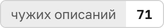
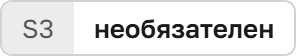
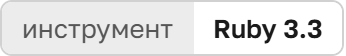
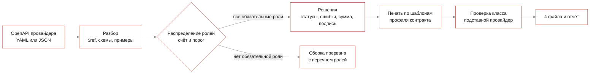

<p align="center">
  <picture>
    <source media="(prefers-color-scheme: dark)" srcset="docs/readme/banner.dark.png">
    
  </picture>
</p>

<p align="center">
  Разработчик платёжного сервиса отдаёт инструменту OpenAPI-описание нового провайдера и получает
  сервис на Ruby по своему контракту, инструкцию по подключению, примеры запросов и отчёт о решениях.
</p>

<p align="center">
  <!-- readme:buttons -->
  <a href="#запуск"><picture><source media="(prefers-color-scheme: dark)" srcset="docs/readme/cta-run.dark.png"></picture></a>
  <a href="docs/guide.md"><picture><source media="(prefers-color-scheme: dark)" srcset="docs/readme/cta-guide.dark.png"></picture></a>
  <a href="docs/rules.md"><picture><source media="(prefers-color-scheme: dark)" srcset="docs/readme/cta-rules.dark.png"></picture></a>
  <!-- /readme:buttons -->
</p>

<p align="center">
  <!-- readme:status -->
  <a href="#результаты"><picture><source media="(prefers-color-scheme: dark)" srcset="docs/readme/badge-status-1.dark.png"></picture></a>
  <a href="#результаты"><picture><source media="(prefers-color-scheme: dark)" srcset="docs/readme/badge-status-2.dark.png"></picture></a>
  <br>
  <a href="#запуск"><picture><source media="(prefers-color-scheme: dark)" srcset="docs/readme/badge-status-3.dark.png"></picture></a>
  <picture><source media="(prefers-color-scheme: dark)" srcset="docs/readme/badge-status-4.dark.png"></picture>
  <a href="LICENSE"><picture><source media="(prefers-color-scheme: dark)" srcset="docs/readme/badge-status-5.dark.png"></picture></a>
  <!-- /readme:status -->
</p>

<p align="center">
  <!-- readme:stack -->
  <picture><source media="(prefers-color-scheme: dark)" srcset="docs/readme/badge-stack-1.dark.png"></picture>
  <picture><source media="(prefers-color-scheme: dark)" srcset="docs/readme/badge-stack-2.dark.png"></picture>
  <picture><source media="(prefers-color-scheme: dark)" srcset="docs/readme/badge-stack-3.dark.png"></picture>
  <picture><source media="(prefers-color-scheme: dark)" srcset="docs/readme/badge-stack-4.dark.png"></picture>
  <br>
  <picture><source media="(prefers-color-scheme: dark)" srcset="docs/readme/badge-stack-5.dark.png"></picture>
  <picture><source media="(prefers-color-scheme: dark)" srcset="docs/readme/badge-stack-6.dark.png"></picture>
  <!-- /readme:stack -->
</p>

<p align="center">
  <!-- readme:nav -->
  <a href="#зачем-это"><picture><source media="(prefers-color-scheme: dark)" srcset="docs/readme/badge-nav-1.dark.png"></picture></a>
  <a href="#как-это-работает"><picture><source media="(prefers-color-scheme: dark)" srcset="docs/readme/badge-nav-2.dark.png"></picture></a>
  <a href="#попробовать-за-две-минуты"><picture><source media="(prefers-color-scheme: dark)" srcset="docs/readme/badge-nav-3.dark.png"></picture></a>
  <br>
  <a href="#результаты"><picture><source media="(prefers-color-scheme: dark)" srcset="docs/readme/badge-nav-4.dark.png"></picture></a>
  <a href="#запуск"><picture><source media="(prefers-color-scheme: dark)" srcset="docs/readme/badge-nav-5.dark.png"></picture></a>
  <a href="#устройство"><picture><source media="(prefers-color-scheme: dark)" srcset="docs/readme/badge-nav-6.dark.png"></picture></a>
  <a href="#ограничения"><picture><source media="(prefers-color-scheme: dark)" srcset="docs/readme/badge-nav-7.dark.png"></picture></a>
  <!-- /readme:nav -->
</p>

> **Решение, принятое без полных данных, не подставляется молча.** Всё, что не удалось вывести из
> описания однозначно, печатается строкой с `!` и записывается в `mapping.yml`, а без обязательной
> роли сборка прерывается с перечнем того, чего не хватило.

## Зачем это

Каждый платёжный провайдер называет одно и то же по-своему: `createPayout` или `orderNo`, сумма в
копейках целым числом или в рублях строкой, ключ в заголовке или Bearer-токен, webhook с подписью или
опрос статуса. Интеграцию под каждого пишут руками и каждый раз заново разбираются в чужом API.

RSOCKET читает описание и сам решает, **какая операция создаёт выплату, какие состояния означают
успех, какие ошибки допускают повтор и в каких единицах передаётся сумма**. Одна сборка даёт четыре
файла в `output/<провайдер>/`: сервис по контракту заказчика, `INTEGRATION.md`, `fixtures.json` и
`mapping.yml` с разбором каждого решения.

## Как это работает



<table>
<tr>
<td valign="top" width="33%">

**1. Роли выбирают правила со счётом**

Правило — поле операции, регулярное выражение и вес. Роль получает операция с наибольшим счётом
не ниже порога, а правила `veto` заранее отсекают, например, `cancelPayout` из кандидатов на создание.

<sub>Счёт, порог и сработавшие правила — в `mapping.yml`, формат в [rules.md](docs/rules.md)</sub>

</td>
<td valign="top" width="33%">

**2. Собранный класс проверяется поведением**

Рядом поднимается подставной провайдер, отвечающий примерами из описания. Класс вызывается по всем
ролям, на каждый успех и каждый описанный отказ, и сверяется адрес, подпись, тело и разбор ответа.

<sub>`spec/integration/tester_spec.rb` вносит в класс ошибки и требует их поймать</sub>

</td>
<td valign="top" width="33%">

**3. Контракт — профиль, а не код**

Интерфейс заказчика задаётся профилем в `app/config/rules/contracts/`. По тому же описанию профиль
`plain_client` собирает класс с другими именами методов и обработкой ошибок, без правок инструмента.

<sub>`bundle exec bin/rsocket contracts` показывает доступные профили</sub>

</td>
</tr>
</table>

## Попробовать за две минуты

После [установки](#запуск) из корня репозитория:

| | Что сделать | Что увидите |
|---|---|---|
| 1 | `bundle exec bin/rsocket build -s examples/novapay/provider_api.yaml -p novapay` | Роли по эндпоинтам, строки `!` с единицами суммы и заголовком подписи, итог «проверок: 28, прошло: 28» и четыре файла |
| 2 | Открыть `output/novapay/mapping.yml` | Для каждой роли операция, счёт при пороге и объяснение, почему выбрана она |
| 3 | Та же команда с `--contract plain_client` | Класс с методами `send_payout`, `payout_state`, `read_callback` и ошибками на исключениях |

Все четыре примера из `examples/` с разными единицами суммы, авторизацией и вложенностью полей
собирает `make examples`. Что получается на выходе, по фрагментам, — в [руководстве](docs/guide.md).

## Результаты

Правила составлялись не по четырём примерам из `examples/`. Замер — на 71 стороннем описании настоящих
провайдеров: Stripe, Adyen, PayPal, Plaid, Wise, Open Banking UK, Modern Treasury и других.

| Корпус | Описаний | Прочитано | Верных назначений ролей |
|---|---|---|---|
| `bench/truth.yml` | 47 | 47 | **178 из 188** |
| `bench/truth-new.yml` | 24 | 24 | **87 из 96** |
| Всего | 71 | 71 | **265 из 284** |

Верным считается и отказ: если провайдер не описывает отмену или webhook, правильно оставить роль
пустой. Описания читаются целиком, включая Swagger 2.0 и файлы на 6 МБ.

**Где ошибаемся.** 19 назначений из 284 неверны. Сам корпус в репозиторий не входит: часть описаний
без лицензии, вместе 17 МБ, поэтому из чистого клона числа не воспроизвести.

## Запуск

Нужен Ruby 3.3.12, версия указана в `.ruby-version`.

```bash
bundle install
bundle exec bin/rsocket build -s examples/novapay/provider_api.yaml -p novapay
```

Результат — в `output/novapay/`. HTTP-сервер с тем же менеджером сборок: `bundle exec bin/rsocket
serve --storage local`, затем `POST /build` на http://127.0.0.1:9292.

<details>
<summary><b>Команды, проверки, контейнеры</b></summary>
<br>

```bash
make help          # все команды
make check         # 404 примера rspec и rubocop
make examples      # собрать все четыре примера
make serve         # HTTP-сервер локально, без S3
docker compose up --build   # MinIO и сервер на localhost:9292
```

Флаги командной строки, ручки HTTP-сервера, работа через S3 и переменные окружения — в
[руководстве](docs/guide.md) и [HTTP API](docs/http-api.md).

</details>

## Устройство

Разбор чужого API и контракт заказчика разделены: в правилах разбора нет имён методов контракта, в
профиле контракта нет имён провайдеров. Ключевое решение, какая операция получает роль, принимает
классификатор по правилам из `app/config/rules/base.yml`.

| Документ | Что внутри |
|---|---|
| [Руководство](docs/guide.md) | Команды, флаги, что вычитывается из описания, файлы на выходе, проверка класса |
| [Правила разбора](docs/rules.md) | Структура `base.yml` и профилей контрактов, как добавить правило или контракт |
| [HTTP API](docs/http-api.md) | Ручки сервера, коды ошибок, S3 и изменение правил на лету |
| [Витрина](web/README.md) | Сайт на React, который показывает разбор вживую; запускается локально через `pnpm dev` |

## Ограничения

- **HTTP-сервер без аутентификации.** По умолчанию слушает только localhost; выставлять его наружу
  без своей защиты нельзя.
- **Числа качества не воспроизводятся из клона.** Корпус из 71 описания лежит вне репозитория по
  лицензионным причинам.
- **Профиль без `probe.rb` не проверяется.** Сборка проходит, но поведение класса не прогоняется,
  причина пишется в отчёт.

<p align="center">
  <picture><source media="(prefers-color-scheme: dark)" srcset="docs/readme/mark.dark.png"></picture>
  <br>
  <sub>Команда GoatWhistle, Hack.Genesis 2026, трек «Генератор интеграций с платёжными провайдерами». Лицензия <a href="LICENSE">MIT</a>.</sub>
</p>
